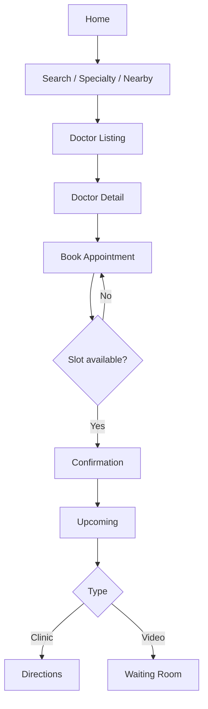

# 02 — User Flows

High-level journeys for the patient app. Screen IDs match [03-screen-map.md](./03-screen-map.md).

---

## 1. First launch & auth

```
Splash (1)
  → if first launch → Onboarding 1–3 (2)
  → if session valid → Home (5)
  → else → Login (3)
       → enter phone → OTP Verification (4)
            → success → Home (5)
            → fail → stay on OTP with error + resend
```

**Notes**
- Splash checks: network, token refresh, remote config (optional), force-update flag.
- Onboarding is skippable after first screen; “Get started” → Login.
- OTP: 4–6 digits, auto-read SMS where platform allows, 30–60s resend cooldown.

---

## 2. Find doctor & book

```
Home (5)
  → Search Doctors (6)  OR  Popular specialty / Featured doctor
       → Doctor Listing (7)  [filters: specialty, gender, fee, distance, availability]
            → Doctor Detail (8)  [profile, reviews, slots]
                 → Book Appointment (9)
                      → pick type: In-clinic | Video
                      → pick date/slot, patient (self / family)
                      → confirm details → Appointment Confirmation (10)
                           → CTA: View upcoming | Home | Add to calendar
```

**Alternate entries**
- Nearby doctors (Home) → Listing with geo filter
- Saved Doctors (23) → Detail → Book
- Continue treatment (Home) → last doctor Detail → Book

---

## 3. Manage appointments

```
Home / Bottom nav “Appointments”
  → Upcoming Appointment (11)
       → Cancel (confirm dialog → success toast/screen)
       → Reschedule → Book Appointment (9) prefilled
       → Directions (maps deep link)
       → Join video → Video Waiting Room (24)
  → Appointment History (12)
       → reopen Detail / book again / view invoice
```

---

## 4. Video consultation

```
Upcoming (11) [type=video, within join window]
  → Video Consultation Waiting Room (24)
       → waiting / connecting / ready
       → Join call (provider SDK or WebView)
       → after call → optional feedback → Home / History
```

**Join window recommendation:** enable “Join” N minutes before slot (e.g. 10–15 min) until slot end + grace.

---

## 5. Digital health locker

```
Bottom nav “Health” (or Home shortcuts)
  → Medical Records hub (13)
       → Digital Prescription (14)
       → Lab Reports (15)
       → Invoices / Documents
       → Vaccination / Allergies / Medicine History
  → Health Vitals (18)  [BP, Sugar, Weight, BMI]
  → Health Timeline (17)  chronological feed of visits + docs + vitals
  → Medicine Reminder (16)
```

This hub is the **digital health locker**. Offline: show last synced locker snapshot with “Last updated” banner.

---

## 6. Family members

```
Profile (27) or Health hub
  → Family Members (19)
       → Add / Edit member
       → Switch “acting as” for booking & records (permissioned)
```

---

## 7. Content & engagement

```
Home → Latest blogs → Health Blogs (21) → Blog Detail (22)
Home → Today’s health tip (inline card, optional deep link to blog)
Notifications (20) → deep link into appointment / Rx / reminder / blog
```

---

## 8. Chat & payments

```
Doctor Detail / Upcoming / Clinic card
  → Chat with Clinic (25)

Profile / Appointment Confirmation / History invoice
  → Payments (26)  [history, pending, pay now]
```

---

## 9. Profile & settings

```
Profile (27)
  → Edit Profile (28)
  → Insurance / Addresses / Saved Doctors (23)
  → Settings (29)  [language, privacy, notifications]
  → Help & Support (30)
  → Logout → Login (3)
```

---

## 10. Offline & recovery flows

| Situation | Behavior |
|-----------|----------|
| No network on Splash | Show offline banner; allow cached session → Home with limited actions |
| Fail mid-booking | Keep form state; retry; do not double-charge |
| Fail loading list | Error state + Retry; optional cached list |
| OTP timeout | Clear message + Resend |
| Force update | Blocking screen with store link |

---

## Flow diagram (core booking)


