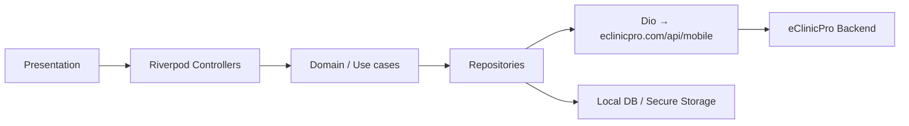

# 04 — Architecture

Flutter patient app architecture for eClinicPro. Patient-only v1.

---

## Goals

- Clear separation: UI → state → domain → data  
- Testable features  
- Offline-friendly health locker & appointment cache  
- Secure token handling  
- Easy to add doctor/clinic apps later as **separate** Flutter apps sharing API contracts, not this codebase’s UI

---

## Recommended stack

| Layer | Choice | Why |
|-------|--------|-----|
| Framework | Flutter 3.x + Dart 3 | Single codebase iOS/Android |
| Routing | `go_router` | Deep links, nested nav, guards |
| State | `flutter_riverpod` (or Bloc if team prefers) | Scalable, testable; Riverpod recommended for greenfield |
| Networking | `dio` + interceptors | Auth headers, refresh, logging |
| Models | `freezed` + `json_serializable` | Immutable, union states |
| Local DB | `drift` (SQLite) or `hive_ce` | Locker + offline; Drift preferred for relational health data |
| Secure storage | `flutter_secure_storage` | Access/refresh tokens |
| Connectivity | `connectivity_plus` + actual request probe | Offline banner |
| Images | `cached_network_image` | Doctor photos, blogs |
| Maps / geo | `geolocator` + url_launcher maps | Nearby + directions |
| Push | Firebase Cloud Messaging | Appointments, reminders |
| Local notifications | `flutter_local_notifications` | Medicine reminders |
| Video | Vendor SDK or secure WebView | Waiting room is ours; media is provider |
| Analytics | Firebase Analytics / Mixpanel | Funnel: OTP → book |
| Crash | Firebase Crashlytics | Stability |
| Env | `flutter_dotenv` / `--dart-define` | Dev / staging / prod API bases |

**API base (prod):** `https://eclinicpro.com/api/mobile`

---

## Layered structure (feature-first)

```
lib/
  main.dart
  app.dart
  core/
    config/          # env, constants
    theme/           # Material 3, colors, typography
    network/         # dio client, interceptors, api_result
    storage/         # secure + preferences
    offline/         # connectivity, sync queue
    widgets/         # AppScaffold, EmptyState, ErrorState, Loading
    router/          # go_router
    utils/
  features/
    auth/
    onboarding/
    home/
    doctors/
    appointments/
    health/          # records, rx, labs, vitals, timeline, reminders
    family/
    notifications/
    blogs/
    chat/
    payments/
    profile/
    video/
  l10n/
```

Each feature folder:

```
feature_name/
  data/          # api, dto, repository impl, local dao
  domain/        # entities, repository interfaces, use cases (optional)
  presentation/  # screens, widgets, providers/controllers
```

---

## State pattern

Prefer **AsyncValue / sealed UI states** per screen:

```text
Idle | Loading | Data(T) | Empty | Error(message, retry) | Offline(cached?)
```

Global concerns via Riverpod:

- `authController` — session  
- `connectivityController` — online/offline  
- `patientProfileProvider`  
- `activeFamilyMemberProvider` — “booking/viewing as”

---

## Auth architecture

1. Login with phone → `POST .../auth/otp/request`  
2. Verify OTP → tokens (`access` + `refresh`) in secure storage  
3. Dio interceptor attaches `Authorization: Bearer <access>`  
4. On 401 → refresh once → retry; else logout  
5. Splash restores session; optional silent refresh  

**Recommendation:** Prefer OTP-only for patients (no password). Optional later: email magic link, Truecaller, Apple/Google if required by stores for some regions.

---

## Offline strategy

| Data | Cache | Offline behavior |
|------|-------|------------------|
| Profile, family | Yes | Read/edit queued |
| Upcoming appointments | Yes | Read-only actions that need net show banner |
| Prescriptions, labs, documents metadata | Yes | Open cached PDFs if downloaded |
| Doctor search / slots | Soft cache short TTL | Require network for booking |
| Chat | Last N messages | Queue send when online |
| Medicine reminders | Local + server | Local notifications work offline |

**Sync:** pull-to-refresh + background sync when connectivity returns. Show “Last synced: …” on Health hub.

**Conflict:** server wins for clinical data; client queues only non-clinical edits (e.g. reminder toggles) with clear UX.

---

## Security & privacy

- TLS only; certificate pinning optional for prod later  
- No PHI in analytics event properties beyond IDs if required  
- PDF/docs in app sandbox; share via system share sheet  
- Biometric unlock (optional Phase 1.5) for app open / locker  
- Clear cache on logout  
- Privacy policy + consent screens linked from Settings  
- Follow platform health-data guidelines; do not claim “HIPAA certified” in UI unless legally true for your deployment

---

## Theming & motion

- Material Design 3 (`ColorScheme`, dynamic optional)  
- Healthcare palette: trust blue/teal primary, soft neutrals — avoid generic purple AI look  
- Expressive but readable typography (e.g. Plus Jakarta / Source Sans — not default Inter-only stack if branding allows custom fonts)  
- Shared motion: page transitions, list item fade/slide, success check animation, skeleton loaders  
- Illustrations: SVG assets for empty/error/offline/success (professional medical)

---

## Environments

| Env | API |
|-----|-----|
| Development | `https://dev.eclinicpro.com/api/mobile` (or local) |
| Staging | `https://staging.eclinicpro.com/api/mobile` |
| Production | `https://eclinicpro.com/api/mobile` |

Use flavors: `dev`, `staging`, `prod`.

---

## Testing pyramid

- Unit: repositories, OTP validation, slot selection  
- Widget: Empty/Error/Loading components, booking form  
- Integration: auth → home golden path (mock API)  
- Manual: video join window, offline locker, payment edge cases  

---

## CI / CD (later)

- GitHub Actions / Codemagic: analyze, test, build  
- Store tracks: internal → closed → production  
- Force-update via remote config / API `min_app_version`

---

## Diagram


